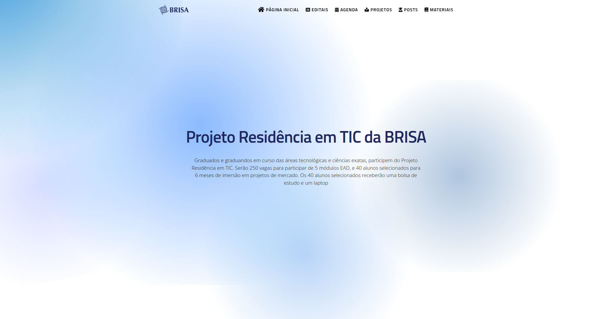
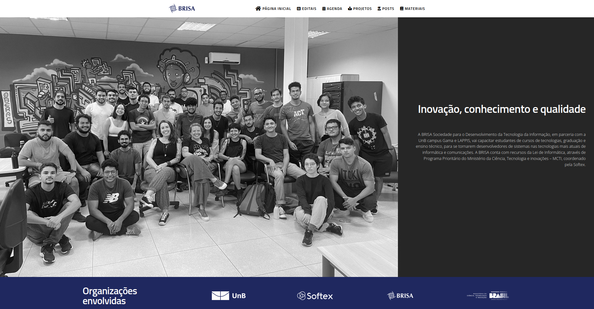
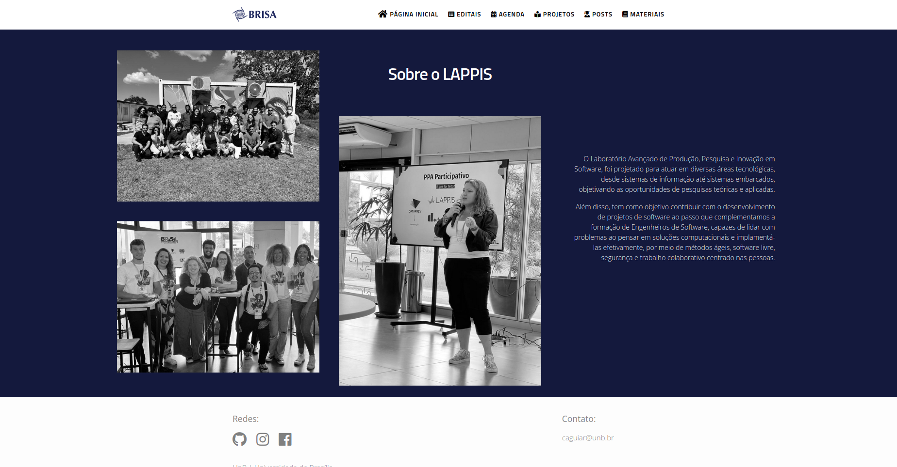
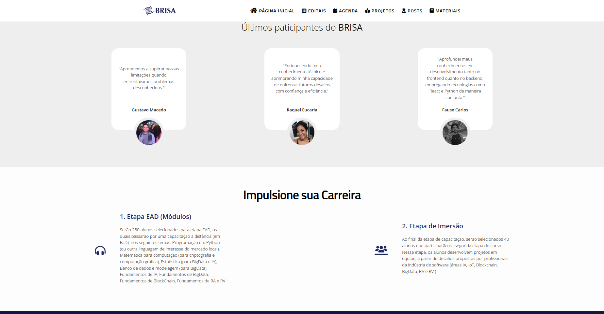

# Métodos de Desenvolvimento de Software (MDS)

Qualifying Software Engineers Undergraduates in DevOps - Challenges of introducing technical and non-technical concepts in a project-oriented course

🌐 **Site da disciplina:** [https://unb-mds.github.io/Qualifying-Software-Engineers-Undergraduates-in-DevOps/](https://unb-mds.github.io/Qualifying-Software-Engineers-Undergraduates-in-DevOps/)

## 📚 Publicações

- [Publication at ICSE - International Conference on Software Engineering (2021)](https://conf.researchr.org/details/icse-2021/icse-2021-Software-Engineering-and-Education-Track/15/Qualifying-Software-Engineers-Undergraduates-in-DevOps-Challenges-of-introducing-te)
- [Link to Preprint](https://arxiv.org/pdf/2102.06662.pdf)

## 📖 Material da Disciplina

Neste repositório você encontra material complementar para a disciplina MDS, incluindo artigos, livros, vídeos e apresentações. O objetivo é fornecer um ambiente de aprendizado aberto e colaborativo.

---

## 🚀 Como Rodar Localmente

### Opção 1: Usando Docker (Recomendado)

A forma mais fácil de rodar o projeto é usando Docker:

```bash
# Clone o repositório
git clone https://github.com/unb-mds/Qualifying-Software-Engineers-Undergraduates-in-DevOps.git
cd Qualifying-Software-Engineers-Undergraduates-in-DevOps

# Inicie o container
docker-compose up
```

O site estará disponível em **http://localhost:4000**

#### Comandos úteis do Docker:

| Comando | Descrição |
|---------|-----------|
| `docker-compose up` | Inicia o servidor |
| `docker-compose up --build` | Rebuild e inicia (após mudanças no Dockerfile) |
| `docker-compose down` | Para o container |
| `docker-compose up -d` | Inicia em background |

### Opção 2: Instalação Manual com Jekyll

```bash
# Instale o Ruby e o Bundler
gem install bundler

# Clone o repositório
git clone https://github.com/unb-mds/Qualifying-Software-Engineers-Undergraduates-in-DevOps.git
cd Qualifying-Software-Engineers-Undergraduates-in-DevOps

# Instale as dependências
bundle install
```

> Desde a limpeza do repositório, `vendor/` (as gems instaladas) não é mais versionado — o `bundle install` acima é obrigatório logo após clonar, tanto no fluxo manual quanto implicitamente dentro do container Docker.

```bash
# Inicie o servidor
bundle exec jekyll serve
```

O site estará disponível em **http://localhost:4000**

---

## 📝 Como Adicionar Novos Conteúdos

### Adicionar Material na aba "Materiais"

Os materiais são gerenciados pelo arquivo `_data/materials.yml`. Para adicionar um novo material:

1. Abra o arquivo `_data/materials.yml`
2. Adicione uma nova entrada seguindo o formato:

```yaml
items:
- curse_name: Nome do Material
  url: https://link-para-o-material.com
  description: Descrição breve do material e seu conteúdo.
  author: https://github.com/seu-usuario.png
```

#### Exemplo completo:

```yaml
items:
- curse_name: Git tutorial | Introdução
  url: https://github.com/giovanni1106/tutorial-git
  description: Um tutorial introdutório de Git, que visa ensinar os fundamentos do Git.
  author: https://github.com/giovanni1106.png

- curse_name: Introdução ao Docker
  url: https://github.com/seu-usuario/tutorial-docker
  description: Tutorial prático sobre containerização com Docker e Docker Compose.
  author: https://github.com/seu-usuario.png
```

### Adicionar Slides/Apresentações

Os slides (PDFs) ficam na pasta `static_files/presentations/`:

1. Coloque o arquivo PDF em `static_files/presentations/`
2. O arquivo estará disponível em `/static_files/presentations/nome-do-arquivo.pdf`

Já slides que devem virar página própria do site (com thumbnail, resumo e link) vão em `_lectures/` — ver "Estrutura do Projeto" abaixo.

### Adicionar Eventos/Aulas

Os eventos ficam na pasta `_events/`, um arquivo por aula, listados em `/aulas/`. O nome do arquivo segue o padrão `AAAA-MM-DD-sN-aulaXX.md` (`sN` = número da sprint/semana) — **a data no nome do arquivo é só uma convenção de organização; quem decide a data exibida é o campo `date:` no front matter.** Recalendarizar o semestre inteiro significa renomear todos os arquivos de `_events/`, como foi feito para 2026/2.

Formato real usado hoje (extraído de `_events/2026-08-17-s0-aula01.md`):

```yaml
---
type: lecture           # 'lecture' ou 'release' — únicos tipos em uso hoje (ver aulas.md)
date: 2026-08-17        # data exibida no card
order: 1                 # ordem de exibição em /aulas/ (inteiro sequencial, sem lacunas)
name: "Aula 01 - Apresentação e contrato pedagógico"
description: "Texto curto exibido no card da aula."
links:                    # opcional
    - url: /planoensino/
      name: Plano de ensino
---
```

> ⚠️ **Não use `title:`/`date:` soltos como único conteúdo do front matter** — isso não corresponde ao que `aulas.md` lê (`type`, `order`, `name`, `description`, `links`), e a aula aparece quebrada no site (sem nome, sem card renderizado corretamente).

---

## 🏗️ Arquitetura do site

O site é gerado com **Jekyll** e publicado pelo GitHub Pages "clássico" (a branch `main` é buildada automaticamente pelo GitHub a cada push — não há GitHub Actions no deploy). Localmente, o build é feito com Docker ou `bundle exec jekyll build`, ambos descritos acima.

**Pastas com `_` são processadas pelo Jekyll de forma especial** (convenção do próprio Jekyll — por padrão qualquer pasta começando com `_` é ignorada, exceto as listadas abaixo):

| Pasta | Papel |
|---|---|
| `_layouts/` | "Moldes" de página (`<head>`, header, footer + `{{ content }}`). Toda página `.md` declara `layout: <nome>` no front matter apontando para um arquivo aqui. |
| `_includes/` | Pedaços de HTML reutilizáveis, chamados de dentro de layouts/páginas com `` (ex: `header.html`, `footer.html`, `nav.html`). |
| `_data/` | YAML lido pelos templates via `site.data.<nome>` — ex: `nav.yml` (menu), `materials.yml` (grid de materiais), `testimony.yml` (depoimentos da home). |
| `_events/` | Collection customizada: uma aula/evento por arquivo, consumida inteira por `aulas.md` (rota `/aulas/`). |
| `_lectures/` | Collection customizada: slides de apoio avulsos, cada um vira uma página própria (`/lectures/LecN/`), linkados a partir de `/materials/` e `/slides/`. |
| `_announcements/` | Collection com `output: false` — dados internos, não gera rota própria. |
| `_sass/` | Estilos SCSS, importados a partir de `_css/main.scss`. `_images/` e `_css/` precisam estar listados em `include:` no `_config.yml`, senão o Jekyll os ignoraria por começarem com `_`. |

**Páginas** ficam soltas na raiz do repositório (`.md` com front matter YAML + HTML embutido livremente no corpo, via Kramdown) — ex: `index.md` (home), `project.md` (`/planoensino/`), `aulas.md` (`/aulas/`), `projetos.md` (`/posts/` — catálogo de projetos dos alunos, **não é um blog**; a URL `/posts/` foi mantida por compatibilidade mesmo com o arquivo-fonte renomeado), `materials.md` (`/materials/`), `lectures.md` (`/slides/`), `Temas<semestre>.md` (catálogo de temas de projeto, linkado a partir de `project.md`).

Onde mexer para cada tarefa comum:

- **Nova aula/evento** → arquivo novo em `_events/` (ver seção "Adicionar Eventos/Aulas" acima).
- **Item novo no menu** → uma linha em `_data/nav.yml`.
- **Material de apoio novo** → item novo em `_data/materials.yml` (ver seção acima).
- **Slide avulso novo** → arquivo novo em `_lectures/`.
- **Catálogo de temas de um novo semestre** → copiar o `Temas<semestre-anterior>.md` mais recente, ajustar o conteúdo, e linkar a partir de `project.md`.

Notas de configuração (`_config.yml`): `future: true` permite publicar eventos com data futura, necessário para o cronograma aparecer completo desde o início do semestre; `archive/` guarda conteúdo histórico fora do build (está listado em `exclude:`).

---

## 📁 Estrutura do Projeto

```
├── _config.yml           # Configurações do Jekyll
├── _data/
│   ├── materials.yml     # Lista de materiais
│   ├── nav.yml           # Menu de navegação
│   └── ...
├── _events/               # Aulas/eventos do cronograma (uma por arquivo)
├── _lectures/             # Slides de apoio avulsos
├── _includes/             # Componentes HTML reutilizáveis
├── _layouts/              # Templates de página
├── _sass/                 # Estilos SCSS
├── static_files/          # Arquivos estáticos (PDFs, imagens)
├── archive/                # Conteúdo histórico, fora do build
├── project.md              # Página do Plano de Ensino (/planoensino/)
├── aulas.md                 # Cronograma (/aulas/)
├── projetos.md               # Catálogo de projetos dos alunos (/posts/)
└── index.md                  # Página inicial
```

---

## 🖼️ Screenshots


<br>



---

## 📧 Contato

- **Professora:** Carla Rocha - caguiar@unb.br
- **Local:** UnB - FCTE - Lab Livre
- **GitHub:** [github.com/unb-mds](https://github.com/unb-mds)
